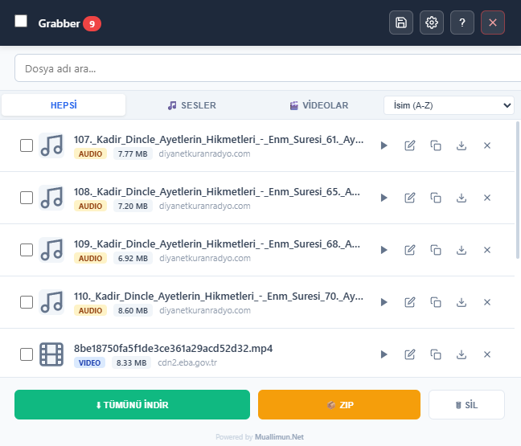

# 🎵 Universal Media Grabber Pro

> **Web sitelerindeki ses, video, belge ve etkileşimli eğitim paketlerini (SCORM) otomatik yakalayan, v30.1.0 ile gelen derin tarama ve akıllı isimlendirme motoruna sahip profesyonel eklenti.**

---

### 🌐 [Chrome Web Mağazası'ndan Yükle](https://chromewebstore.google.com/detail/universal-media-grabber-p/klhmnkfafcadbppabkcnokacaflafhdk) | 🦊 [Firefox Eklentilerinden Yükle](https://addons.mozilla.org/tr/firefox/addon/universal-media-grabber-pro/)

---

## 📸 Önizleme

## 🌟 Neden Universal Media Grabber Pro?

Bu eklenti, sıradan araçların aksine medya ve belge yakalama sürecini tamamen kişiselleştirilebilir ve profesyonel bir deneyime dönüştürür:

| Özellik | Açıklama |
| :--- | :--- |
| **🎓 Eğitim & SCORM Desteği** | Özellikle **EBA** (eba.gov.tr) ve eğitim platformlarındaki ders videolarını, belgeleri ve SCORM etkileşimli eğitim paketlerini gerçek isimleriyle saniyeler içinde yakalar. |
| **🔍 Derin Sayfa Taraması** | Gizli belgeleri (PDF, DOC vb.) aramakla uğraşmayın! **"TARA"** butonu veya sağ tık menüsü ile sayfa içine gömülü tüm dosyaları anında listeleyin. |
| **🏷️ Akıllı İsimlendirme** | Dosyalarınız asla karışmaz! Yakalanan medyalar "videoplayback" yerine web sayfası başlığı veya sanatçı etiketleri analiz edilerek otomatik isimlendirilir. |
| **🛡️ Güçlü Reklam Kalkanı** | Reklam ağlarından gelen sahte medya linklerini ve 2MB altındaki kısa reklam videolarını otomatik olarak filtreler. |
| **📦 Toplu İndirme & ZIP** | Düzinelerce dosyayı tek tek indirmek yerine, seçtiğiniz tüm medyaları ve paketleri saniyeler içinde tek bir **ZIP arşivi** olarak indirin. |
| **🎯 Siteye Özel Kurallar** | Ziyaret ettiğiniz her site için özel kural (Örn: Sadece Ses, Sadece Belge, Engelle) belirleyin. |

## 🚀 Kurulum

### 1. Mağazalar Üzerinden (Önerilen)
Otomatik güncellemelerden yararlanmak için tarayıcınıza uygun mağazadan yükleyin:
- [Chrome için Tıklayın](https://chromewebstore.google.com/detail/universal-media-grabber-p/klhmnkfafcadbppabkcnokacaflafhdk)
- [Firefox için Tıklayın](https://addons.mozilla.org/tr/firefox/addon/universal-media-grabber-pro/)

### 2. Geliştirici Modu (Manuel)
1. Bu depoyu (repository) **ZIP** olarak indirin ve klasöre çıkarın.
2. Chrome'da `chrome://extensions`, Firefox'ta `about:debugging` adresine gidin.
3. Geliştirici Modunu aktif edin ve klasörü yükleyin.

## 📖 Nasıl Kullanılır?

1. **Yakalayın:** Bir web sitesinde medya oynatın veya **Tara (🔍)** butonuna basarak sayfadaki dosyaları bulun.
2. **Kişiselleştirin:** Ayarlar (⚙️) menüsünden klasörleme, reklam kalkanı ve isimlendirme formatını belirleyin.
3. **Yönetin:**
    * ▶ **Önizleme:** Eklenti içinden ses veya videoyu kontrol edin.
    * ✏️ **Düzenle (Menü):** İsmi değiştirin, siteyi engelleyin veya URL'yi kopyalayın.
    * 🗑 **Temizle:** Gereksiz dosyaları listeden kaldırın.
    * 📦 **ZIP / İndir:** Seçilenleri tek tek veya ZIP arşivi olarak kaydedin.

> **⚠️ ÖNEMLİ AYAR (Toplu İndirme İçin)**
>
> Kesintisiz toplu indirme için: Tarayıcı **Ayarlar** > **İndirmeler** kısmına gidin ve **"İndirmeden önce her dosyanın nereye kaydedileceğini sor"** seçeneğini **KAPATIN**.

## 🛠️ Kullanılan Teknolojiler

* **JavaScript (Vanilla)** - Çerçevesiz, saf performans.
* **WebExtensions API (Manifest V3)** - Modern, güvenli ve tarayıcılar arası (Cross-browser) mimari.
* **Offscreen API / JSZip** - Tarayıcıyı dondurmadan arka planda büyük boyutlu dosya sıkıştırma.
* **HTML5 & CSS3** - Gece/Gündüz modlu responsive tasarım.

## 🤝 Katkıda Bulunma

Geliştirme önerileri için **Pull Request** gönderebilir veya hataları **Issues** bölümünden bildirebilirsiniz.

## 📄 Lisans

Bu proje **MIT Lisansı** ile lisanslanmıştır. Özgürce kullanılabilir ve dağıtılabilir.

---

Developed with ❤️ by **[Muallimun.Net](https://www.muallimun.com/MediaGrabberPro/)**
